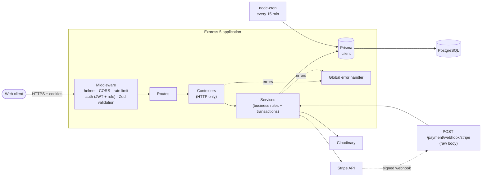
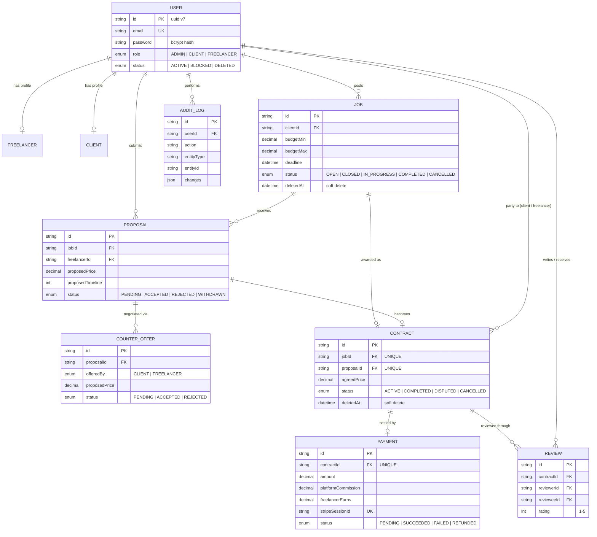
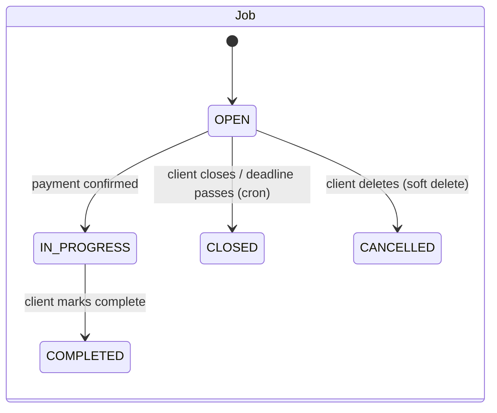
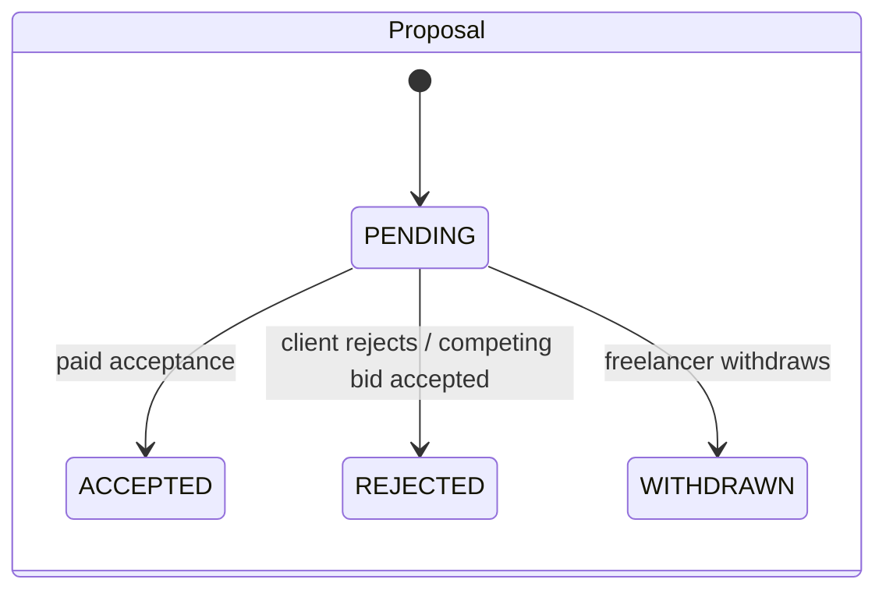
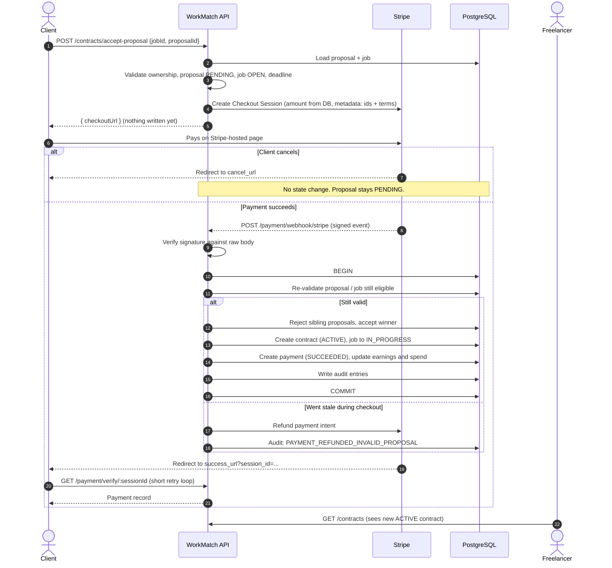

<div align="center">

# WorkMatch API

**A production-deployed freelance marketplace backend: jobs, proposals, counter-offers, payment-gated contracts, reviews and an admin back-office.**

[](https://api.workmatch.dibbockb.com)
[](https://workmatch.dibbockb.com)


[Live API](https://api.workmatch.dibbockb.com) · [Live Frontend](https://workmatch.dibbockb.com) · [Frontend Repo](https://github.com/dibbockb/workmatch) · [Backend Repo](https://github.com/dibbockb/workmatch-backend) · [API Docs](https://documenter.getpostman.com/view/54867039/2sBYHQ2NuZ)

</div>

---

## Table of Contents

1. [Overview](#overview)
2. [Quick Links](#quick-links)
3. [Highlights](#highlights)
4. [Tech Stack](#tech-stack)
5. [Architecture](#architecture)
6. [Data Model](#data-model)
7. [Lifecycle & State Machines](#lifecycle--state-machines)
8. [Core Engineering Decisions](#core-engineering-decisions)
9. [Payment-Gated Contract Flow](#payment-gated-contract-flow)
10. [API Reference](#api-reference)
11. [Getting Started](#getting-started)
12. [Environment Variables](#environment-variables)
13. [Project Structure](#project-structure)
14. [Known Limitations & Roadmap](#known-limitations--roadmap)
15. [Author](#author)

---

## Overview

WorkMatch connects **clients** who post jobs with **freelancers** who bid on them. The API covers the whole engagement lifecycle:

> post a job → receive proposals → negotiate with counter-offers → **pay via Stripe to accept** → work → mark complete → mutual reviews

Three roles (`CLIENT`, `FREELANCER`, `ADMIN`) share one API. Each has a distinct permission surface, enforced in middleware and re-checked in the service layer.

The interesting part of this codebase is not the CRUD. It is how **money, state transitions and concurrency** are handled. See [Core Engineering Decisions](#core-engineering-decisions).

## Quick Links

| Resource | URL |
| --- | --- |
| Live API | https://api.workmatch.dibbockb.com |
| Live frontend | https://workmatch.dibbockb.com |
| Backend repository | https://github.com/dibbockb/workmatch-backend |
| Frontend repository | https://github.com/dibbockb/workmatch |
| Postman collection | [`postman-api-docs.json`](https://github.com/dibbockb/workmatch-backend/blob/main/postman-api-docs.json) |

Health check:

```bash
curl https://api.workmatch.dibbockb.com/
# { "success": true, "message": "workmatch server running..." }
```

## Highlights

- **Payment-gated acceptance.** A proposal is only accepted, and a contract only created, after Stripe confirms payment. Abandoning checkout leaves no state behind.
- **Atomic multi-table transitions.** Accepting a proposal rejects competing bids, creates the contract, moves the job to `IN_PROGRESS`, records the payment, updates earnings and writes the audit log in a single database transaction.
- **Verified Stripe webhooks** with raw-body signature verification, server-side re-validation and automatic refund if the proposal went stale during checkout.
- **Integrity enforced in the database**: unique constraints and indexes, not just application checks.
- **Cookie-based JWT auth** (httpOnly access and refresh tokens) with a Bearer-header fallback, and a per-request user check so blocking an account takes effect immediately.
- **Uniform error pipeline.** Zod, Prisma, JWT, Multer and domain errors all map to one response envelope.
- **Audit trail written inside the same transaction** as the business change it describes.
- **Layered rate limiting** (global, auth and payment tiers), Helmet, CORS allow-list and bcrypt hashing.

## Tech Stack

| Layer | Technology |
| --- | --- |
| Runtime / language | Node.js, TypeScript |
| Framework | Express 5 |
| Database | PostgreSQL via Prisma 7 (`@prisma/adapter-pg`) |
| Validation | Zod 4 |
| Auth | JWT (access + refresh), bcryptjs, cookie-parser |
| Payments | Stripe Checkout + webhooks |
| Uploads | Multer (memory storage) → Cloudinary |
| Security | Helmet, CORS allow-list, express-rate-limit |
| Scheduling | node-cron |
| Tooling | tsx (dev), tsup (build), Biome (lint/format) |

## Architecture

Each business domain is a self-contained module following a strict **route → controller → service** flow. Shared infrastructure lives beside the modules.



**Why this shape**

- Controllers only translate HTTP to and from service calls. All rules and transactions live in services, so they are testable without Express.
- The Stripe webhook route is registered **before** `express.json()` so Stripe's signature can be verified against the untouched raw body.
- Cross-cutting behaviour (auth, validation, errors, rate limits) is middleware, not copy-pasted per route.

## Data Model



**Integrity guarantees that live in the schema, not in application code**

| Constraint | What it prevents |
| --- | --- |
| `Proposal @@unique([jobId, freelancerId])` | A freelancer bidding twice on the same job (even under a race) |
| `Contract.jobId @unique`, `Contract.proposalId @unique` | Two contracts for one job or one proposal |
| `Payment.contractId @unique`, `Payment.stripeSessionId @unique` | Duplicate payment rows for a contract or a checkout session |
| `Review @@unique([contractId, reviewerId])` | Reviewing the same contract twice |
| `Decimal(10,2)` on every monetary column | Floating-point money drift |
| Indexes on `status`, `clientId`, `freelancerId`, `deadline`, `proposalId` | Full scans on the hot list and filter queries |

## Lifecycle & State Machines





Contracts start `ACTIVE` and move to `COMPLETED` when the client marks them complete. `DISPUTED` and `CANCELLED` exist in the enum as reserved states and are not yet reachable through the API.

## Core Engineering Decisions

Each entry covers the decision, the reasoning, and the trade-off I accepted.

### 1. The Stripe webhook is the source of truth for acceptance

**Decision.** `POST /contracts/accept-proposal` performs validation only and returns a Stripe Checkout URL. It writes nothing. The contract, payment and status changes happen inside the `checkout.session.completed` webhook, driven by metadata attached to the session.

**Why.** Creating the contract first and charging later leaves orphaned `ACTIVE` contracts whenever a client abandons checkout, and cleanup becomes its own problem. With this design a cancelled checkout means nothing was ever written, so there is nothing to undo.

**Trade-off.** The client's browser lands on the success page before the webhook may have landed, so the frontend polls `GET /payment/verify/:sessionId` briefly. The state change is eventually consistent by a second or two.

### 2. Re-validate inside the webhook, and refund if the world changed

**Decision.** When the webhook fires, the proposal and job are re-checked (`PENDING`, `OPEN`, deadline not passed). If anything went stale while the client was on Stripe's page, the payment is refunded automatically and an audit entry is written. No contract is created.

**Why.** Time passes between "client clicks accept" and "Stripe confirms". Another bid could win, the freelancer could withdraw, or the deadline could pass. Taking money for a contract that cannot exist is worse than a failed purchase.

### 3. One transaction for every multi-table transition

**Decision.** Paid acceptance (reject sibling proposals, accept the winner, create the contract, set the job `IN_PROGRESS`, create the payment, update freelancer earnings and client spend, write audit entries) runs in one `prisma.$transaction`. So do job completion, review creation (including the rating aggregate) and user registration (user plus role profile).

**Why.** Any partial failure would otherwise leave an inconsistent marketplace, for example a job in progress with no contract, or a review without an updated average.

### 4. Prices never come from the client

**Decision.** The accept endpoint takes only IDs. The amount charged is read from the stored proposal (`proposedPrice`), converted to integer cents for Stripe, and the 10% platform commission is computed server-side.

**Why.** An API that accepts an amount from the browser is an API that gets paid one cent. Money columns are `Decimal(10,2)`, never `Float`.

### 5. Constraints belong in the database

**Decision.** Duplicate bids, duplicate contracts, duplicate payments and duplicate reviews are blocked by unique constraints. The service layer also checks and returns friendly `409` errors, but the schema is the last line of defence.

**Why.** Application-level "check then insert" has a race window. A unique index does not.

### 6. Auth that survives real browsers and real incidents

**Decision.** Access and refresh JWTs are issued as `httpOnly` cookies (`secure` + `sameSite=none` in production, `lax` in development), with an optional parent-domain cookie so the API subdomain and the Next.js frontend share a session. A Bearer header is accepted as a fallback for API clients. The auth middleware re-loads the user on **every** request and rejects blocked accounts.

**Why.** `httpOnly` keeps tokens out of reach of XSS. The per-request lookup costs one indexed query and means an admin block is effective immediately instead of after token expiry.

**Trade-off.** Refresh tokens are stateless, so logout clears cookies but does not revoke a token that was copied elsewhere. See the roadmap.

### 7. One error pipeline

**Decision.** A single global handler maps `ZodError`, Prisma known and validation errors, JWT errors, Multer errors, a domain `AppError` and unknown errors to one envelope. Stack traces appear only in development. A `catchAsync` wrapper keeps controllers free of try/catch.

**Why.** Clients can rely on one error shape, and internals never leak in production.

### 8. Audit logging joins the business transaction

**Decision.** `logAction` takes a Prisma transaction client, so the audit row commits or rolls back together with the change it records.

**Why.** An audit log that can disagree with reality is worse than none.

### 9. Expiry is enforced twice

**Decision.** A cron job closes `OPEN` jobs past their deadline every 15 minutes, and the public listing independently filters `deadline > now`.

**Why.** Cron gives a clean data state, and the read-time filter means users never see an expired job in the 15-minute gap, nor if the scheduler is down.

### 10. Search and filtering semantics chosen on purpose

**Decision.** Budget filters use **range overlap** (`job.budgetMax ≥ min` and `job.budgetMin ≤ max`) instead of exact bounds, skills use `hasSome`, text search is case-insensitive over title and description, and every list returns pagination metadata (`page`, `limit`, `total`, `totalPages`). A composite index covers the client dashboard query (`clientId, status, deadline, createdAt`).

### 11. Soft deletes where history matters

**Decision.** Jobs and contracts carry `deletedAt`. Deleting a job marks it `CANCELLED` and hides it from reads, and related proposals and contracts keep their history.

### 12. Rate limiting by risk

**Decision.** Three independent, env-tunable limiters sit in front of the API: global, auth (login and register) and payment. Credential stuffing and checkout abuse are throttled far harder than normal browsing.

## Payment-Gated Contract Flow



## API Reference

Base URL: `https://api.workmatch.dibbockb.com/api/v1`

The full, runnable request set is in the [Postman collection](https://github.com/dibbockb/workmatch-backend/blob/main/postman-api-docs.json).

**Auth**

| Method | Endpoint | Access | Description |
| --- | --- | --- | --- |
| POST | `/auth/register` | Public | Register as `CLIENT` or `FREELANCER` (multipart, optional avatar) |
| POST | `/auth/login` | Public | Log in, sets httpOnly cookies |
| POST | `/auth/logout` | Public | Clears auth cookies |
| POST | `/auth/refresh-token` | Cookie | Issues a fresh token pair |
| GET | `/auth/me` | Any role | Current user |

**Jobs**

| Method | Endpoint | Access | Description |
| --- | --- | --- | --- |
| GET | `/jobs` | Public | Paginated list; filters: `status`, `skills`, `budgetMin`, `budgetMax`, `search`, `sortBy`, `page`, `limit` |
| GET | `/jobs/search` | Public | Search jobs |
| GET | `/jobs/:jobId` | Public | Job details |
| GET | `/jobs/my-posted` | Client | Own jobs |
| POST | `/jobs` | Client | Create job (Zod-validated) |
| PATCH | `/jobs/:jobId` | Client | Update an open job |
| POST | `/jobs/:jobId/close` | Client | Close a job |
| DELETE | `/jobs/:jobId` | Client | Soft delete |

**Proposals & counter-offers**

| Method | Endpoint | Access | Description |
| --- | --- | --- | --- |
| POST | `/proposals` | Freelancer | Submit a proposal |
| GET | `/proposals/freelancer/my-proposals` | Freelancer | Own proposals (filter + paginate) |
| GET | `/proposals/job/:jobId` | Client | Proposals on a job you own |
| GET | `/proposals/:proposalId` | Client, Freelancer | Proposal details |
| POST | `/proposals/:proposalId/withdraw` | Freelancer | Withdraw a pending proposal |
| POST | `/proposals/:proposalId/reject` | Client | Reject a pending proposal |
| POST | `/proposals/:proposalId/counter-offer` | Client | Send a counter-offer (one pending at a time) |
| POST | `/proposals/counter-offer/:counterOfferId/accept` | Freelancer | Accept a counter-offer |
| POST | `/proposals/counter-offer/:counterOfferId/reject` | Freelancer | Reject a counter-offer |

**Contracts & payments**

| Method | Endpoint | Access | Description |
| --- | --- | --- | --- |
| POST | `/contracts/accept-proposal` | Client | Validate and return a Stripe `checkoutUrl` |
| GET | `/contracts` | Client, Freelancer | Own contracts |
| GET | `/contracts/:contractId` | Client, Freelancer, Admin | Contract (participants or admin only) |
| PATCH | `/contracts/:contractId/mark-complete` | Client | Complete the contract and job |
| GET | `/payment/verify/:sessionId` | Client, Admin | Look up the payment for a checkout session |
| GET | `/payment/:paymentId` | Participants | Payment details |
| POST | `/payment/initiate` | Client | Pay for an existing contract (legacy path) |
| POST | `/payment/webhook/stripe` | Stripe signature | Webhook receiver |

**Reviews, uploads, admin**

| Method | Endpoint | Access | Description |
| --- | --- | --- | --- |
| POST | `/review` | Authenticated | Review the other party of a completed contract |
| GET | `/review/freelancer/:freelancerId` | Public | A freelancer's reviews |
| GET | `/review/client/:clientId` | Public | A client's reviews |
| POST | `/upload` | Authenticated | Upload a file to Cloudinary |
| GET | `/admin/users` | Admin | List users |
| PATCH | `/admin/users/:userId/block` | Admin | Block a user (reason is audited) |
| PATCH | `/admin/users/:userId/unblock` | Admin | Unblock a user |
| GET | `/admin/dashboard` | Admin | Totals plus platform revenue |
| GET | `/admin/audit-logs` | Admin | Audit trail |

**Response envelope**

```jsonc
// success
{ "success": true, "statusCode": 200, "message": "…", "data": { }, "meta": { "page": 1, "limit": 10, "total": 42, "totalPages": 5 } }

// failure
{ "success": false, "message": "Validation failed", "errors": [{ "path": "budgetMax", "message": "…" }] }
```

## Getting Started

### Prerequisites

- Node.js 20.19+ (22 LTS recommended)
- PostgreSQL
- [pnpm](https://pnpm.io/) and [Bun](https://bun.sh/) (the build and seed scripts invoke Bun)
- A [Stripe](https://stripe.com/) account in test mode and the [Stripe CLI](https://stripe.com/docs/stripe-cli)
- A [Cloudinary](https://cloudinary.com/) account

### 1. Clone and install

```bash
git clone https://github.com/dibbockb/workmatch-backend.git
cd workmatch-backend
pnpm install
```

### 2. Configure environment

Create a `.env` in the project root using the [variables below](#environment-variables). Never commit it.

### 3. Prepare the database

```bash
pnpm prisma generate
pnpm prisma db push
```

Optionally seed demo data (1 admin, 10 clients, 20 freelancers, 50 jobs with proposals, counter-offers, contracts, payments and reviews):

```bash
pnpm prisma db seed
```

Seeded demo accounts: `admin@workmatch.com`, `client@workmatch.com`, `freelancer@workmatch.com`. The seed ships with a placeholder bcrypt hash. Replace `DEMO_PASSWORD_HASH` in `src/app/utils/seed.ts` with a hash of a password you know.

### 4. Run

```bash
pnpm dev
```

The API listens on `http://localhost:5000`.

### 5. Forward Stripe webhooks (separate terminal)

```bash
pnpm stripe:webhook
```

Copy the `whsec_…` secret it prints into `STRIPE_WEBHOOK_SIGNING_SECRET` and restart the server. Without the forwarder, payments succeed on Stripe's side but the webhook that creates the contract never reaches your machine.

Use Stripe's test card `4242 4242 4242 4242` with any future expiry and any CVC.

### Scripts

| Script | Purpose |
| --- | --- |
| `pnpm dev` | Dev server with watch (tsx) |
| `pnpm build` | Generate Prisma client and bundle with tsup |
| `pnpm start` | Run the compiled build |
| `pnpm stripe:webhook` | Forward Stripe events to localhost |
| `pnpm lintcheck` | Biome lint and format check |
| `pnpm format` | Biome auto-fix |

## Environment Variables

| Variable | Description |
| --- | --- |
| `NODE_ENV` | `development` or `production` (controls cookie flags and error detail) |
| `PORT` | HTTP port (default used in docs: `5000`) |
| `DATABASE_URL` | PostgreSQL connection string |
| `SERVER_URL` | Public API URL |
| `CLIENT_URL` | Frontend origin (CORS allow-list and Stripe redirect URLs) |
| `COOKIE_DOMAIN` | Optional parent domain for sharing auth cookies with the frontend |
| `BCRYPT_SALT_ROUNDS` | bcrypt cost factor |
| `JWT_ACCESS_SECRET`, `JWT_REFRESH_SECRET` | JWT signing secrets |
| `JWT_ACCESS_EXPIRES_IN`, `JWT_REFRESH_EXPIRES_IN` | Token lifetimes, e.g. `15m`, `7d` |
| `STRIPE_PUBLISHABLE_KEY`, `STRIPE_SECRET_KEY` | Stripe API keys |
| `STRIPE_WEBHOOK_SIGNING_SECRET` | Webhook signing secret (`whsec_…`) |
| `GLOBAL_MAX_TRY`, `AUTH_MAX_TRY`, `PAYMENT_MAX_TRY` | Requests per 15 minutes per IP for each limiter |
| `CLOUDINARY_CLOUD_NAME`, `CLOUDINARY_API_KEY`, `CLOUDINARY_API_SECRET` | Cloudinary credentials |

## Project Structure

```text
prisma/
└── schema/                 # Split schema: one file per aggregate + enums
src/
├── app.ts                  # Middleware stack, rate limiters, route mounting
├── server.ts               # DB connect, cron start, listen
└── app/
    ├── envConfig/          # Typed environment access
    ├── lib/                # Prisma, Stripe, Cloudinary, Multer clients
    ├── middleware/         # auth + roles, Zod validation, 404, global error handler
    ├── module/
    │   ├── admin/
    │   ├── auth/
    │   ├── contract/
    │   ├── job/
    │   ├── payment/
    │   ├── proposal/
    │   ├── review/
    │   └── upload/         # each: route → controller → service (+ validation)
    └── utils/              # AppError, catchAsync, sendResponse, JWT, audit log, cron, seed
```

## Known Limitations & Roadmap

I would rather list these than have you find them.

- **No escrow yet.** Freelancer earnings are recorded when payment is confirmed, not held until completion. A proper hold-and-release model (and payouts via Stripe Connect) is the next payments milestone.
- **Counter-offer acceptance** currently creates the contract directly. It should be routed through the same payment-gated checkout flow as a direct acceptance.
- **Webhook idempotency.** Duplicate delivery of the same event should be short-circuited by a processed-event or session ledger.
- **No automated test suite yet.** Priority targets are the webhook flow and the state-transition rules, using Vitest and Supertest against a disposable database.
- **Migrations are not committed**, so local setup uses `prisma db push`. Committing versioned migrations and running them in CI is planned.
- **Stateless refresh tokens.** Logout clears cookies but cannot revoke a copied token. A server-side revocation list or rotation family would close this.

## Author

**Dibbo Chakraborty** · [GitHub @dibbockb](https://github.com/dibbockb)

Built as a full-stack project spanning this API and a [Next.js frontend](https://github.com/dibbockb/workmatch).

---
This Readme was written with AI assistance and human supervision.